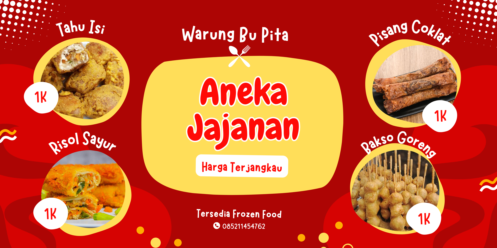
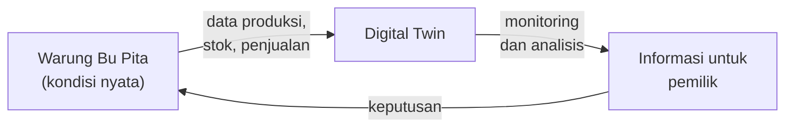

  

<h1 align="center">Pengembangan Digital Twin UMKM Warung Bu Pita</h1>

  Monitoring produksi, persediaan, dan penjualan untuk usaha jajanan skala kecil

  
  
  
  
  

  
  
  

---

## Tentang Proyek

Repository ini berisi dokumentasi dan hasil pengerjaan proyek Digital Twin untuk **Warung Bu Pita**, UMKM yang menjual aneka jajanan seperti tahu isi, risol sayur, pisang coklat, dan bakso goreng, serta menyediakan frozen food.

Pencatatan produksi, stok bahan, dan penjualan di warung masih dilakukan secara manual, sehingga pemilik sulit melihat kondisi usaha secara utuh. Digital Twin dipakai sebagai representasi digital dari kondisi warung yang diperbarui dengan data aktual, agar aktivitas usaha bisa dipantau lebih terstruktur.

## Ruang Lingkup

| Aspek | Yang dipantau | Manfaat bagi warung |
|-------|---------------|---------------------|
| Produksi | Jumlah produksi harian per menu | Produksi lebih terencana dan tidak berlebih |
| Persediaan | Stok bahan baku dan barang jadi | Stok menipis diketahui lebih awal |
| Penjualan | Jumlah terjual per menu | Menu yang laris dan yang sepi mudah terlihat |

## Rencana Pengembangan

| Tahap | Kegiatan | Keluaran |
|-------|----------|----------|
| 1. Perencanaan | Menyusun ruang lingkup, pihak terkait, dan rincian pekerjaan | Project Charter, Stakeholder Register, WBS |
| 2. Analisis kebutuhan | Mengamati alur kerja warung dan mengumpulkan data produksi, stok, dan penjualan | Daftar kebutuhan dan alur proses |
| 3. Perancangan | Merancang model Digital Twin untuk tiga aspek yang dipantau | Rancangan model dan struktur data |
| 4. Pengembangan | Membangun pencatatan data dan tampilan monitoring | Prototipe sistem |
| 5. Pengujian | Mencoba prototipe dengan data nyata dari warung | Hasil uji dan catatan perbaikan |
| 6. Evaluasi | Menilai manfaat sistem bagi pemilik dan menyusun laporan akhir | Laporan proyek |

## Anggota Kelompok

| | Nama | Peran | GitHub |
|:-:|------|-------|--------|
|  | Chika Dena | Project Manager | [@chikadena](https://github.com/chikadena) |
|  | M. Firdausyah | Anggota | [@Mfirdaus809](https://github.com/Mfirdaus809) |
|  | Nazwa Dara Musyaraf | Anggota | [@nazwa-daraa](https://github.com/nazwa-daraa) |
|  | Irma Suraya | Anggota | [@irmalgs048-coder](https://github.com/irmalgs048-coder) |
 
## Dokumentasi

| Dokumen | Lokasi |
|---------|--------|
| Project Charter | [Digital Twin UMKM Warung Bu Pita](<./Digital Twin UMKM Warung Bu Pita>) |
| Stakeholder Register | [Digital Twin UMKM Warung Bu Pita](<./Digital Twin UMKM Warung Bu Pita>) |
| Work Breakdown Structure (WBS) | [Digital Twin UMKM Warung Bu Pita](<./Digital Twin UMKM Warung Bu Pita>) |
| Function Point | [Digital Twin UMKM Warung Bu Pita](<./Digital Twin UMKM Warung Bu Pita>) |
---

  Repository ini dibuat untuk keperluan tugas perkuliahan MPPL 2026.

